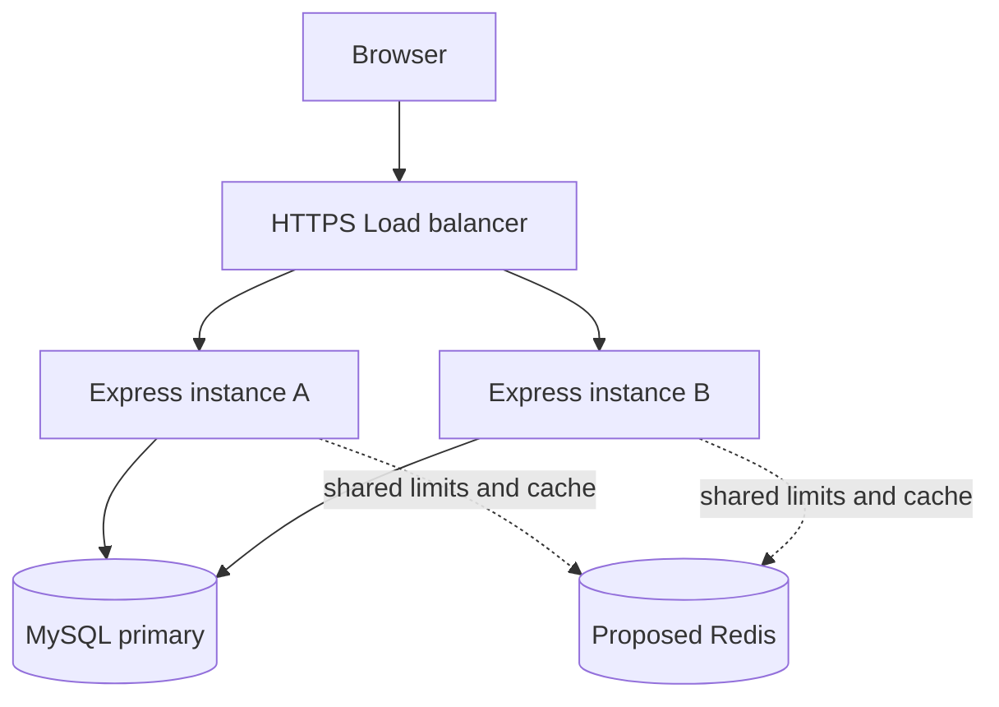

# แผนรองรับการขยายระบบครัวแบ่งปัน

เอกสารประกอบ W14 และ Final ของ 67160003. ระบบที่ทดสอบจริงมี Express หนึ่ง process กับ MySQL หนึ่ง instance. แผนภาพด้านล่างเป็นข้อเสนอ ไม่ใช่ระบบที่ deploy แล้ว. ยังไม่มี load test จึงไม่อ้างจำนวนผู้ใช้หรือ throughput ที่รองรับได้.

## จุดที่ควรวัดก่อนเพิ่ม instance

| ส่วน | กลไกปัจจุบัน | ความเสี่ยงเมื่อข้อมูลหรือ traffic เพิ่ม |
| --- | --- | --- |
| GET recipes | COUNT หนึ่ง query และ JOIN พร้อม LIMIT/OFFSET อีกหนึ่ง query | OFFSET ลึกและ search แบบ contains อาจ scan มาก. วัด query plan ก่อนเพิ่ม composite index หรือเปลี่ยน keyset pagination |
| GET recipe detail และ ratings | รายละเอียดอ่านสูตรกับวัตถุดิบ. คะแนนอ่าน parent กับรายการรีวิว | จำนวนรีวิวต่อสูตรยังไม่แบ่งหน้า. วัดจำนวน rows และเวลาจริงก่อนแยก read model |
| POST login | scrypt ที่มี salt และ rate limit 10 ครั้งต่อนาทีต่อ IP | งาน hash ใช้ CPU และ thread pool. ต้องวัดการแย่งงานก่อนปรับ concurrency |
| GET categories | cache ใน process อายุ 30 วินาที | แต่ละ instance มี cache ของตนเอง. การเพิ่มหมวดหมู่ในอนาคตต้องมี invalidation |
| Meal discovery | timeout, GET retry 2 ครั้ง, fallback | upstream ช้าอาจทำให้มี request รอพร้อมกันมาก. แยก budget และวัดจำนวน request ค้าง |

คาดว่าฐานข้อมูลจะเป็นจุดที่ต้องตรวจเมื่อ read traffic เพิ่มสิบเท่า เพราะ list ทำสอง queries และ ratings ยังไม่แบ่งหน้า. นี่เป็นสมมติฐานจากโค้ด ไม่ใช่ผล benchmark. ยังไม่มี traffic telemetry ยืนยันว่า endpoint ใดถูกเรียกบ่อยที่สุด.

## แบบออกแบบสอง instances

## สิ่งที่ต้องเปลี่ยนก่อนขยายจริง

| รายการ | สถานะปัจจุบัน | สิ่งที่ต้องทำก่อนใช้หลาย instances |
| --- | --- | --- |
| Session และ Authentication | JWT อายุ 15 นาที. Browser เก็บ token ใน memory. Server อ่าน user และ role จาก DB ทุก authenticated request | ทุก instance ต้องใช้ issuer, audience และ secret รุ่นเดียวกันผ่าน secret manager. เพิ่ม rotation, revocation และ TLS สำหรับ production |
| Cache และ rate limit | Map/cache และ limiter store อยู่ในแต่ละ process | ใช้ shared store สำหรับ quota และ invalidation. ตั้ง trusted proxy ตาม topology จริงเท่านั้น ห้ามเปิด trust proxy โดยไม่จำกัด |
| Uploads | ไม่มี upload endpoint. ภาพประกอบเป็น static assets ในโครงการ | จึงไม่มีไฟล์ผู้ใช้อยู่บน local disk. หากเพิ่ม upload ใช้ object storage พร้อมตรวจชนิดและขนาดไฟล์ |
| Database connections | pool จำกัด 10 connections ต่อ instance. queueLimit=0 ยังไม่จำกัด queue | สอง instances มีเพดาน pool รวม 10 × 2 = 20. กำหนด queue และ timeout จากผล load testก่อนใช้งานจริง |

MySQL fixture ที่อ่านจริงมี `@@max_connections=151` ตาม `.transaction/final-mysql-results.json`. หากกัน 21 connections สำหรับผู้ดูแลและงานอื่น จะเหลือ 130 หรือเพดานเชิง configuration 13 instances ที่ pool 10. ตัวเลขนี้ไม่ใช่จำนวน instances ที่รับประกันประสิทธิภาพ. ยังมีข้อจำกัด CPU, RAM, locks และ connection ของเครื่องมืออื่น. ไม่ใช้ค่าเพดานนี้เป็นเหตุผลเปิด 13 instances ทันที.

## Migration และ Expand-Contract

Migration ที่ทำจริงคือ `001-password-hash`: เพิ่ม nullable password_hash โดยไม่แก้แถวธุรกิจเดิม แล้ว provision เฉพาะบัญชี fixture ผ่าน setup-demo. Runner มี version ledger และตรวจ schema ตอนรันซ้ำ. ทดสอบ UP/DOWN/UP บนฐานข้อมูลแยกแล้ว. DOWN ลบ password hashes จึงใช้ได้ใน fixture เท่านั้นหลังหยุดรับ login. ไม่ใช่ขั้นตอน rollback production ที่ปลอดภัยต่อ session ทุกกรณี.

ตัวอย่างอนาคตเมื่อแยกชื่อสูตรเป็นหลายภาษาใช้ Expand-Contract.

1. Expand เพิ่มตาราง recipe_translations โดยยังเก็บ recipes.name. เวอร์ชันเก่าและใหม่ยังอ่านได้.
2. Backfill ทีละ batch พร้อมตรวจจำนวนและ checksum. โค้ดใหม่อ่านแบบ fallback และเขียนทั้งสองที่ใน transaction เดียว.
3. เปลี่ยนการอ่านหลังตรวจข้อมูลและ deploy ครบทุก instance. เฝ้าดู error และ query latency.
4. Contract ลบ field เก่าหลังยืนยันว่าไม่มี caller เก่าและมี backup restore ที่ทดสอบแล้ว. ก่อนขั้นนี้ rollback ใช้ application รุ่นเดิมได้. หลังลบต้องใช้ forward repair หรือ restore ตามแผน.

ไม่ได้ติดตั้ง load balancer, Redis, cluster หรือ read replica ในงานนี้. W13 ประเมินแบบออกแบบแยกบริการ และ W14 ใช้แผนขยายระบบ. ไม่สร้างบริการจำลองเพื่ออ้างว่าเป็น distributed deployment.
